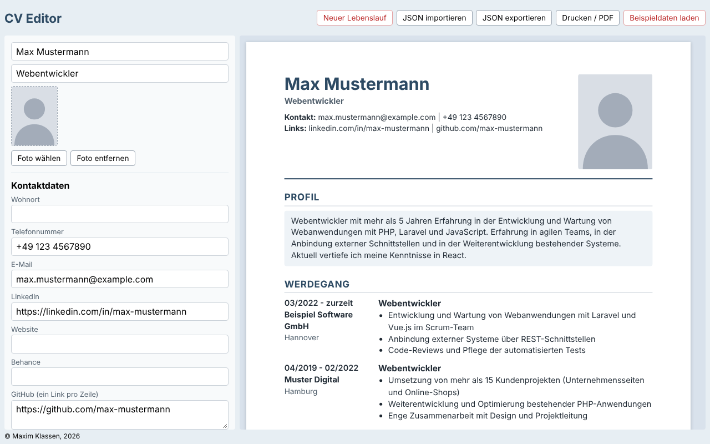

# CV Editor

React-Webanwendung zum schnellen Erstellen und Bearbeiten eines Lebenslaufs mit Live-Vorschau und JSON-Speicherung.

Lernprojekt: Abschlussprojekt im Kurs „App-Entwicklung“ (React), Hochschule Hannover. Einzelarbeit.



## Inhalt

1. [Idee und Zielsetzung](#idee-und-zielsetzung)
2. [Funktionen](#funktionen)
3. [Installation und Start](#installation-und-start)
4. [Projektstruktur](#projektstruktur)
5. [Umsetzung](#umsetzung)
6. [Entscheidungen und Herausforderungen](#entscheidungen-und-herausforderungen)
7. [Einschränkungen und Weiterentwicklung](#einschränkungen-und-weiterentwicklung)
8. [Datenschutz](#datenschutz)

## Idee und Zielsetzung

**Was ist die Anwendung?** Ein Editor für Lebensläufe. Links gibt man die Daten in einem Formular ein, rechts zeigt eine Live-Vorschau den fertigen Lebenslauf auf einem DIN-A4-Blatt.

**Welches Problem löst sie?** Ich habe meinen Lebenslauf bisher direkt als HTML-Code gepflegt. Jede Änderung, etwa die Anpassung an eine neue Stelle, erforderte einen Eingriff in den Quelltext. Der CV Editor trennt Inhalt und Darstellung: Der Inhalt liegt als strukturierte Daten (JSON) vor, das Layout wird automatisch erzeugt.

**Zielgruppe:** Bewerberinnen und Bewerber, die ihren Lebenslauf übersichtlich pflegen und schnell für verschiedene Bewerbungen anpassen möchten.

## Funktionen

| # | Funktion | Beschreibung |
|---|----------|--------------|
| 1 | Live-Vorschau | Jede Eingabe erscheint sofort im Lebenslauf |
| 2 | Abschnitte hinzufügen und löschen | Drei Typen: klassischer Abschnitt, Zertifikate/Weiterbildungen, Kenntnisse |
| 3 | Positionen hinzufügen, bearbeiten und löschen | Die Felder hängen vom Abschnittstyp ab |
| 4 | Unterabschnitte | Gruppen von Positionen, z. B. „Frühere Positionen“ |
| 5 | Reihenfolge ändern | Abschnitte und Positionen lassen sich nach oben/unten verschieben |
| 6 | Zeitraum mit „zurzeit“ | Monatsauswahl, Checkbox für laufende Tätigkeiten |
| 7 | Foto-Upload | Das Bild wird automatisch verkleinert |
| 8 | JSON exportieren und importieren | Der Lebenslauf lässt sich als Datei sichern und wieder laden |
| 9 | Automatisches Speichern | Alle Änderungen bleiben im Browser (localStorage) erhalten |
| 10 | Neuer Lebenslauf / Beispieldaten | Leeren Lebenslauf anlegen oder die Beispieldaten laden |
| 11 | Drucken / PDF | Es wird nur der Lebenslauf gedruckt, im Format DIN A4 |
| 12 | Skalierte Vorschau | Das Blatt passt sich der Breite des Fensters an |

Beschreibungen können Listen enthalten: Zeilen, die mit `- ` beginnen, werden in der Vorschau zu Aufzählungspunkten.

## Installation und Start

Voraussetzung: [Node.js](https://nodejs.org) ab Version 20.19 (bzw. 22.12).

```bash
npm install        # Abhängigkeiten installieren
npm run dev        # Entwicklungsserver starten (http://localhost:5173)
```

Weitere Befehle:

```bash
npm run build      # Produktions-Build im Ordner dist/
npm run preview    # Produktions-Build lokal ansehen
npm run lint       # Code mit oxlint prüfen
```

**Bedienung:** Beim ersten Start sind Beispieldaten geladen. Mit „Neuer Lebenslauf“ beginnt man bei null, mit „JSON importieren“ lädt man einen eigenen Lebenslauf. Die Beispieldatei `src/data/data.json` zeigt die Struktur.

## Projektstruktur

```
docs/screenshot.png             Screenshot für diese README
src/
├── App.jsx                      Wurzelkomponente: State, Speichern, Aufbau der Seite
├── App.css                      Stile der Oberfläche (Formular, Kopfzeile, Druck)
├── index.css                    Globale Grundstile
├── main.jsx                     Einstiegspunkt
├── data/
│   └── data.json                Beispieldaten (fiktive Person)
├── state/
│   ├── cvModel.js               Datenmodell: Abschnittstypen, Fabrikfunktionen, Normalisierung
│   ├── cvReducer.js             Reducer: alle Änderungen am Lebenslauf
│   └── CvDispatchContext.js     Context + Hook für dispatch
├── Tools/                       Das Formular (linke Seite)
│   ├── Toolbar.jsx              Import, Export, Drucken, Neu, Beispieldaten
│   ├── Panel.jsx                Gesamtes Formular
│   ├── StaticData.jsx           Name, Titel, Foto, Kontaktdaten, Profil
│   ├── SectionAdd.jsx           Neuen Abschnitt anlegen
│   ├── Section.jsx              Ein Abschnitt mit seinen Positionen
│   ├── Position.jsx             Eine Position oder ein Unterabschnitt (rekursiv)
│   ├── Field.jsx                Beschriftetes Eingabefeld
│   └── ItemControls.jsx         Knöpfe: nach oben, nach unten, löschen
├── Templates/                   Die Vorschau (rechte Seite)
│   ├── ScaledPage.jsx           A4-Blatt, das sich der Breite anpasst
│   ├── ScaledPage.css           Blattgröße, Schatten, Druckeinstellungen
│   └── Default/
│       ├── Preview.jsx          Lebenslauf als HTML
│       └── preview.css          Stil des Lebenslaufs
└── utils/
    ├── format.js                Datum, Links und Beschreibungstext formatieren
    ├── storage.js               localStorage
    └── files.js                 JSON-Download, Datei lesen, Foto verkleinern
```

## Umsetzung

### Datenfluss

```
Eingabe im Formular
      │  onChange
      ▼
dispatch({ type, ... })  ──►  cvReducer  ──►  neuer Zustand (cv)
                                                   │
                       ┌───────────────────────────┼─────────────────────┐
                       ▼                           ▼                     ▼
               Panel (Formular)            Preview (Vorschau)     useEffect: speichern
```

Der gesamte Lebenslauf liegt als **ein JavaScript-Objekt** in einem einzigen State in `App`. Das JSON wird beim Start oder Import geladen und danach als Objekt bearbeitet; beim Speichern und Export wird es wieder in JSON umgewandelt. Formular und Vorschau zeigen nur diesen Zustand an. Änderungen sind ausschließlich über `dispatch` möglich.

### Datenmodell

```json
{
    "name": "Max Mustermann",
    "title": "Webentwickler",
    "contact": { "address": "", "phone": "", "email": "", "linkedin": "", "website": "", "behance": null, "github": ["https://github.com/..."] },
    "profile": "Text (leer = Abschnitt wird nicht angezeigt)",
    "photo": "data:image/jpeg;base64,...",
    "sections": [
        {
            "type": "default",
            "title": "Werdegang",
            "positions": [
                { "title": "Webentwickler", "firm": "Firma", "location": "Ort",
                  "start": "2022-03", "end": null, "description": "- Punkt 1\n- Punkt 2" },
                { "chapter": true, "title": "Frühere Positionen", "positions": [ ... ] }
            ]
        }
    ]
}
```

| Abschnittstyp | Felder einer Position |
|---------------|-----------------------|
| `default` (klassisch) | `title`, `firm`, `location`, `start`, `end`, `description`; zusätzlich Unterabschnitte (`chapter: true` mit eigener `positions`-Liste) |
| `certificates` | `title`, `organisation`, `start`, `end` |
| `skills` | `title` (Kategorie), `description` |

- `end: null` bedeutet „zurzeit“, ein leerer Text bedeutet „kein Enddatum anzeigen“.
- Beim Laden bekommt jeder Abschnitt und jede Position eine `id` (`normalizeCv`). Sie wird als `key` in Listen gebraucht und muss nicht in der JSON-Datei stehen.

### State Management mit useReducer

Die Daten sind bis zu drei Ebenen tief verschachtelt (Abschnitt → Position → Position im Unterabschnitt) und werden auf viele Arten geändert. Deshalb liegt die gesamte Änderungslogik im Reducer (`state/cvReducer.js`) und nicht verteilt in den Komponenten. Die Komponenten schicken nur Aktionen.

| Aktion | Wirkung |
|--------|---------|
| `SET_FIELD`, `SET_CONTACT` | Name, Titel, Foto, Profil bzw. Kontaktfeld ändern |
| `ADD_SECTION`, `UPDATE_SECTION`, `REMOVE_SECTION`, `MOVE_SECTION` | Abschnitte verwalten |
| `ADD_POSITION`, `UPDATE_POSITION`, `REMOVE_POSITION`, `MOVE_POSITION` | Positionen und Unterabschnitte verwalten |
| `LOAD` | Gesamten Lebenslauf ersetzen (Import, „Neuer Lebenslauf“, Beispieldaten) |

Wichtige Prinzipien:

- **Unveränderlichkeit:** Der Zustand wird nie direkt geändert, sondern immer kopiert (`{...}`, `map`, `filter`). React erkennt Änderungen an der neuen Referenz; `useEffect` mit `[cv]` würde sonst nicht auslösen.
- **Reine Funktion:** Der Reducer erzeugt keine Zufallswerte. Neue `id`s entstehen in der Komponente und kommen fertig in der Aktion an. (Im Entwicklungsmodus ruft `StrictMode` den Reducer doppelt auf, um Seiteneffekte zu entdecken.)
- **Rekursion:** `editPositionList` sucht eine Position per `id` auch in verschachtelten Unterabschnitten. Ändern, Löschen und Verschieben funktionieren so auf jeder Ebene mit demselben Code.

### React-Konzepte im Überblick

| Konzept | Ort | Zweck |
|---------|-----|-------|
| `useReducer` (mit lazy Initialisierung) | `App.jsx` | Zentraler Zustand; `initCv` läuft nur einmal beim Start |
| `useEffect` | `App.jsx` | Seiteneffekt: bei jeder Änderung im localStorage speichern |
| `useState` | `SectionAdd.jsx` | Lokaler Zustand: gewählter Abschnittstyp |
| `useRef` | `Toolbar.jsx` | Zugriff auf das versteckte Datei-Input für den Import |
| `useLayoutEffect` + `useRef` | `ScaledPage.jsx` | Größe messen, bevor der Browser zeichnet |
| `ResizeObserver` (Browser-API) | `ScaledPage.jsx` | Maßstab bei Änderung von Fensterbreite und Inhalt neu berechnen |
| `useContext` (eigener Hook `useCvDispatch`) | `CvDispatchContext.js` | `dispatch` ohne Weiterreichen durch alle Ebenen |
| Props | überall | `cv`, `section`, `position`, `isFirst`, `isLast` usw. fließen nach unten |
| Controlled Components | `Field.jsx`, `StaticData.jsx` | `value` kommt aus dem State, `onChange` sendet eine Aktion |
| Rekursive Komponente | `Position.jsx` | Ein Unterabschnitt rendert wieder `Position` |
| Listen mit `key` | `Panel`, `Section`, `Preview` | Stabile `id` statt Index |
| Bedingtes Rendern | `Position.jsx`, `Preview.jsx` | Felder und Darstellung je nach Abschnittstyp |

### Komponenten

**Formular (`Tools/`)**

- `Panel` setzt das Formular aus `StaticData`, `SectionAdd` und der Liste der `Section`-Komponenten zusammen.
- `Section` zeigt Titel, Positionen und die Knöpfe zum Hinzufügen. „Unterabschnitt“ gibt es nur bei klassischen Abschnitten.
- `Position` zeigt je nach Abschnittstyp andere Felder und enthält die Zeitraum-Eingabe (`PeriodFields`). Bei einem Unterabschnitt rendert sie ihre Kinder wieder mit `Position`.
- `Field` (Label umschließt das Eingabefeld, daher keine `id`s nötig) und `ItemControls` (↑ ↓ ✕) sind kleine, wiederverwendete Bausteine.
- `Toolbar` enthält Import, Export, Drucken, „Neuer Lebenslauf“ und „Beispieldaten laden“. Vor Aktionen, die Daten ersetzen, fragt sie nach.

**Vorschau (`Templates/`)**

- `Preview` ist eine reine Funktion des Zustands und hat keinen eigenen State. Sie ist in kleine Komponenten aufgeteilt (`CvSection`, `PositionRow`, `Chapter`, `CertificateRow`, `SkillsBox`, `Period`, `Description`). Das HTML entspricht meinem bisherigen Lebenslauf (gleiche CSS-Klassen).
- `ScaledPage` zeigt den Lebenslauf auf einem Blatt mit fester Breite von 210 mm. Das Blatt wird mit `transform: scale(...)` genau auf die verfügbare Breite gebracht, die Anordnung innerhalb des Blattes ändert sich dabei nicht. Weil `transform` die Höhe im Layout nicht ändert, setzt die Komponente die Höhe des Wrappers selbst (Blatthöhe × Maßstab). Beim Drucken ist die Skalierung abgeschaltet, das Blatt hat dann exakt 210 mm.
- Der Ordner `Templates/Default/` ist darauf vorbereitet, später weitere Vorlagen aufzunehmen.

### Weitere Umsetzungsdetails

- **Datum:** `<input type="month">` liefert `2022-03`; die Vorschau zeigt `03/2022` (`formatMonth`).
- **Beschreibungstext:** `parseDescription` macht aus Zeilen mit `- ` Listen und aus anderen Zeilen Absätze.
- **Foto:** `imageToDataUrl` verkleinert das Bild auf einem `<canvas>` (längste Seite 400 px, JPEG), damit es in JSON und localStorage passt.
- **Export:** `downloadJson` erzeugt ein `Blob` und eine temporäre Download-URL.
- **Import:** Die Datei wird gelesen, mit `JSON.parse` geparst und mit `isValidCv` auf eine gültige Struktur geprüft. Bei Fehlern erscheint eine Meldung, der aktuelle Lebenslauf bleibt unverändert.
- **Speichern:** Alle `localStorage`-Zugriffe stehen in `try/catch`, damit die App auch ohne Speicher (z. B. privater Modus) funktioniert.
- **Drucken:** `@media print` blendet Formular, Kopf- und Fußzeile aus, `@page` setzt DIN A4 mit Rändern. Überschriften bleiben mit ihrem Inhalt zusammen (`break-after: avoid`).
- **CSS:** Formular und Lebenslauf verwenden beide Klassen wie `position` und `section`. Deshalb sind die Stile des Formulars auf `.tool-panel` und die des Lebenslaufs auf `.cv` begrenzt; ohne diese Trennung beeinflussten sich die Stile gegenseitig.

## Entscheidungen und Herausforderungen

**Warum `useReducer` statt `useState`?** Verschachtelte Daten und viele Änderungsarten: Die Logik steht an einer Stelle, ist testbar und die Komponenten bleiben einfach.

**Warum Context nur für `dispatch`?** `dispatch` wäre sonst durch vier Ebenen (`App → Panel → Section → Position → Position`) als Prop weitergereicht worden. Es ändert sich nie, deshalb löst der Context keine zusätzlichen Renderings aus. Die Daten (`cv`) bleiben als Props, weil die Komponenten sie lesen und der Datenfluss so sichtbar bleibt.

**Warum kein `useMemo` / `useCallback` / `React.memo`?** Es gibt kein messbares Leistungsproblem; ein Lebenslauf hat nur wenige Dutzend Elemente. `useCallback` bringt ohne `React.memo` bei den Kindkomponenten nichts. Die Optimierung wäre vorzeitig und würde den Code komplizierter machen.

**Warum eine eigene Funktion für Beschreibungstexte statt `react-markdown`?** Gebraucht werden nur Absätze und Listen (15 Zeilen Code). In einem Test mit `react-markdown` wuchs das JavaScript-Bundle von 238 kB auf 357 kB (82 zusätzliche Pakete). Zudem verhält sich Markdown bei einfachen Zeilenumbrüchen anders als gewünscht.

**Herausforderungen**

- *Verschachtelte Daten:* Positionen in Unterabschnitten sollten mit demselben Code geändert werden wie normale Positionen. Lösung: Suche per `id` mit Rekursion (`editPositionList`).
- *Stabile `key`s:* Ohne eindeutige `id`s würden beim Löschen oder Verschieben die Eingabefelder durcheinandergeraten. Lösung: `id`s beim Laden vergeben (`normalizeCv`).
- *Reiner Reducer:* `id`s dürfen nicht im Reducer erzeugt werden. Lösung: Erzeugung in der Komponente, die `id` ist Teil der Aktion.
- *Gleiche Klassennamen in Formular und Lebenslauf:* Stile aus dem Formular „liefen“ in die Vorschau. Lösung: die Formularstile für `.section` und `.position` auf `.tool-panel` begrenzen und die Stile des Lebenslaufs auf `.cv`.
- *Skalierung:* Eine Scrollleiste, die erscheint und die Breite verändert, würde den Maßstab ständig neu berechnen lassen. Lösung: `scrollbar-gutter: stable`.

## Einschränkungen und Weiterentwicklung

Bekannte Einschränkungen:

- In den Daten gibt es Felder, die die Anwendung noch nicht verwendet: `theme`, `schema`, `version`, `date`, `location`, `signature`. Sie sind für spätere Erweiterungen (Vorlagen, Farbschemata, Unterschriftszeile) vorgesehen.
- Automatisierte Tests sind nicht Teil des Projekts. Die Funktionen wurden im Browser (Chromium) geprüft.
- Es gibt kein Rückgängig/Wiederholen.
- Die Vorschau wird auf die volle Breite des Fensters skaliert, auch auf sehr großen Bildschirmen.

Mögliche Weiterentwicklung:

- Weitere Vorlagen und Farbschemata (`Templates/`)
- Rückgängig/Wiederholen (der Reducer macht das leicht umsetzbar: Verlauf der Zustände speichern)
- Sortieren per Drag-and-drop
- Fett, Kursiv und Links in Beschreibungen (z. B. mit Markdown)
- Mehrere Lebensläufe verwalten
- Automatisierte Tests für Reducer und Komponenten

## Datenschutz

Es gibt keinen Server. Alle Daten bleiben im Browser (localStorage) bzw. in den exportierten JSON-Dateien. Eigene JSON-Dateien enthalten persönliche Daten und gehören nicht in das öffentliche Repository; im Repository liegen nur fiktive Beispieldaten.

## Lizenz und Autor

MIT-Lizenz, siehe [LICENSE](LICENSE).

Maxim Klassen, 2026
